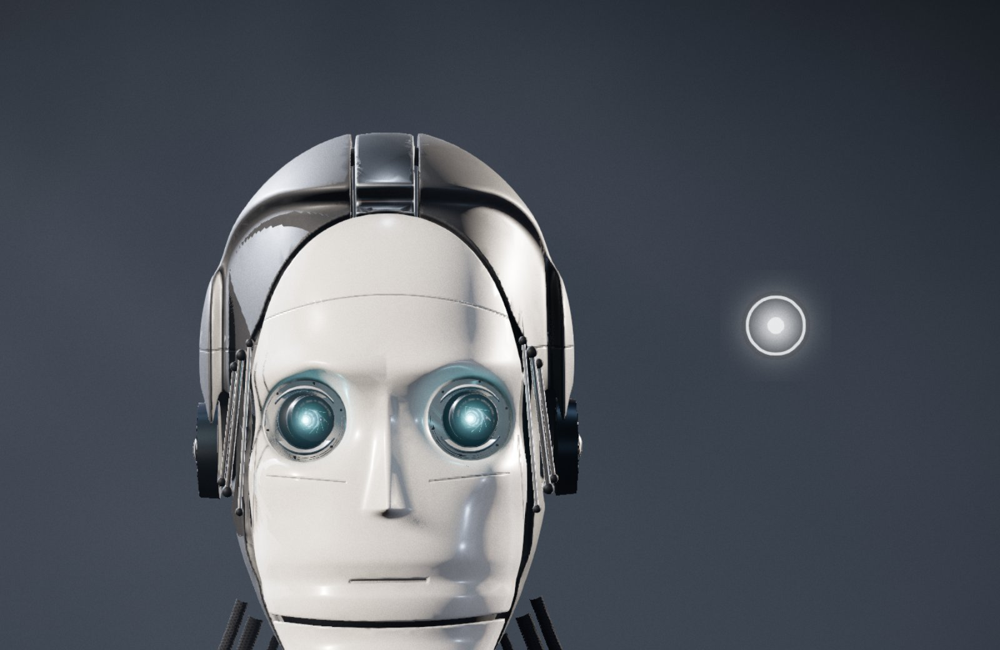
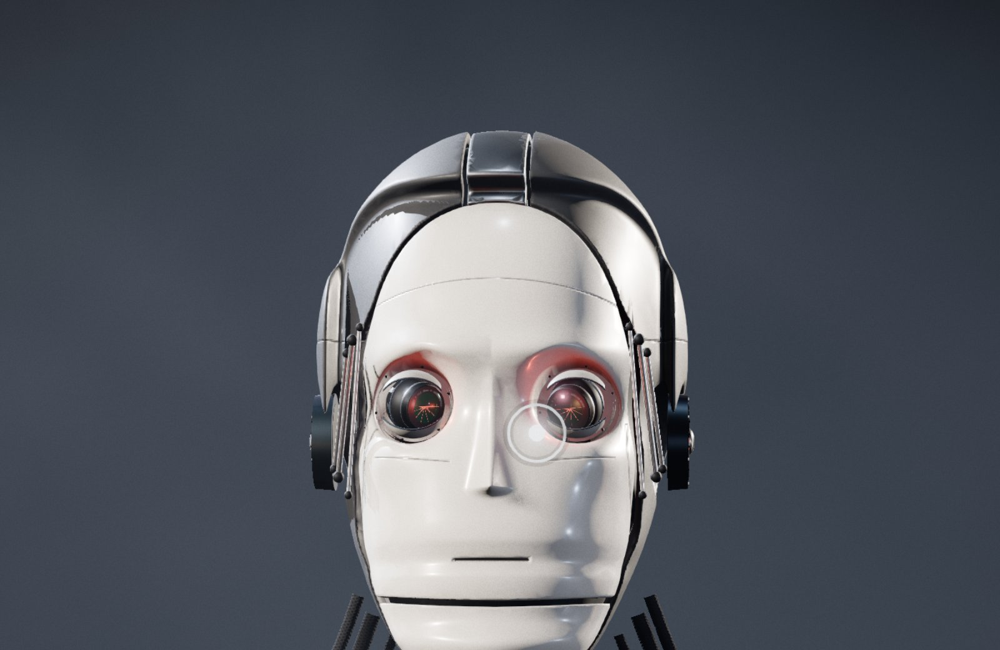
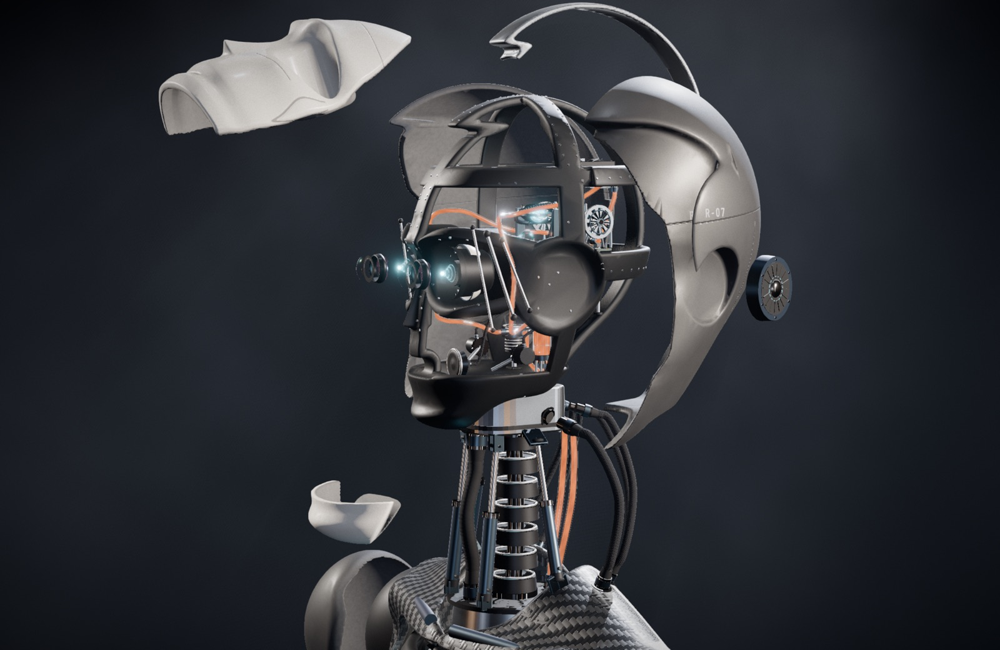

# Robot — Artificial Media

Robot iza ekrana, izdvojen iz projekta [head-tracking-3d](https://github.com/artme-nx/head-tracking-3d):
web kamera prati položaj tvojih očiju, a scena se iscrtava off-axis projekcijom tako da se monitor
ponaša kao **prozor** — kad pomakneš glavu, perspektiva se mijenja kao u stvarnosti (efekt Johnny Lee /
Sony Spatial Reality Display). Hard-surface android poprsje gleda točno u tvoje oči.

**Glava upravlja kamerom, ruke upravljaju robotom:** ista kamera prati i do dvije ruke — robot prati vrh
tvog prsta, ljuti se kad ga diraš i rastavlja se na otvoren dlan; dvjema rukama uokviriš kadar kao redatelj.

**Živo:** https://artme-nx.github.io/robot/

| Robot | Robot prati prst | Prekrižene oči (prst blizu lica) |
| --- | --- | --- |
|  |  |  |

| Ljutnja (prst predugo blizu) | Rastavljen robot (otvoren dlan) | Rastavljen — s boka |
| --- | --- | --- |
|  |  |  |

| Redateljski okvir | Izrez kadra |
| --- | --- |
|  |  |

Stack: Vite + vanilla JS + Three.js, MediaPipe Tasks Vision (FaceLandmarker + HandLandmarker),
pmndrs `postprocessing` + N8AO, meshoptimizer za generiranu geometriju.

## Robot

- Glava od zasebnih keramičkih/karbonskih panela s **pravim procjepima** (SDF ljuske), kroz procjepe na
  sljepoočnicama vidi se mehanika; panel linije, natpisi i serijski brojevi; mehanički vrat s kralješcima,
  hidraulikom (klipnjače klize), pletenim kabelima i rebrastim crijevom.
- **Oči** su slojevi prave geometrije: duboka duplja s vijcima → kućište → objektiv s gravurom →
  iris-blenda od 11 lamela → emisivni prstenovi na različitim dubinama → užarena jezgra → staklena
  rožnica s AR prevlakom → mehanički kapci. Svjetlo iz očiju je pravo svjetlo (obasjava duplju i lice).
- Oči gledaju **točno u 3D položaj tvojih očiju** (konvergencija za blizu/daleko), uz sakade (kratki
  pogledi na tvoje lijevo/desno oko i usta), mikrosakade i tremor. Glava i vrat slijede s kašnjenjem i
  inercijom (opruga s prigušenjem i "servo" mrtvom zonom). Kad se približiš, blenda se sužava i jezgra
  posvijetli. Povremeno trepće kapcima ili zatvaranjem blende; suptilno "diše".
- `E` mijenja boju očiju: ledeno cijan ↔ jantarna.
- **Ruke:** ispruženi kažiprst privuče pogled — oči prestanu gledati tebe i prate vrh prsta u 3D-u (blizu lica
  konvergiraju i iris-blende se suze), a kad spustiš ruku, pogled se glatko vrati prema G pravilima. Dodir lica:
  glava ustukne na opruzi, oči bljesnu, blende se zatvore pa otvore; prst blizu dulje od ~2 s i robot se naljuti
  (crvene oči, jače pulsiranje, servo trzaji, stisnuti kapci), a kad makneš ruku, smiri se.
- **Rastavljanje:** otvoren dlan s raširenim prstima rastavi glavu i poprsje kao tehnički prikaz proizvoda
  (količina prati raširenost prstiju). Kabeli vrata se iskopčaju i bočni klipovi uvuku, maska se preklopi gore kao
  vizir, polovice kranija i uši odu u stranu, slojevi očiju se razmaknu duž optičke osi; unutra su kavez s
  prozorima, procesor s hladnjakom, servo motori, optički kabeli, kralježnica i reaktor u prsima. Šaka sve vrati
  obrnutim redom: dijelovi sjednu s malim odskokom, spojevi kratko zasvijetle, blende škljocnu.
- **Vlastita glava:** ispusti .glb/.gltf glave bilo gdje u prozor — model sjeda na vrat, dobiva duplje i
  iste mehaničke oči (automatsko pozicioniranje). `↑`/`↓` fino pomiče oči, `[`/`]` veličina, `R` okret.

Dok se robot priprema (geometrija u workerima, HDR, fontovi, shaderi), stoji crni ekran s natpisom
*Artificial Media*; kad se robot iscrta i render se smiri, ekran se glatko odtopi.

## Ruke — geste

Kamera vidi ruke koje su podignute ispred ekrana (otprilike u visini lica). Položaj ruke u kadru postaje
točka u 3D sceni, a **primicanje ruke ekranu gura točku dublje prema robotu** (dubina iz veličine dlana,
relativno na udaljenost tvoje glave). Bez kamere geste se mogu glumiti mišem (vidi Prečaci).

| Gesta | Kako | Robot |
| --- | --- | --- |
| **Ispruženi kažiprst** | kažiprst gore, ostali prsti savijeni | **oči prate vrh prsta**; blizu lica konvergiraju (prekriže se) i blende se suze; `H` uključuje marker na vrhu prsta |
| **Dodir** (kažiprstom) | primakni prst robotovu licu | robot se **trgne** (glava ustukne, oči bljesnu, blende se zatvore pa otvore); prst blizu > ~2 s → **ljutnja** (crvene oči, pulsiranje, servo trzaji) |
| **Otvoren dlan** | svi prsti ispruženi i **rašireni** | **rastavljanje** glave i poprsja; količina prati koliko su prsti rašireni (ostaje kad spustiš ruku) |
| **Šaka** | svi prsti savijeni, palac uvučen | **sklapanje** obrnutim redom, s "klikom" i bljeskom spojeva; vraća normalni kadar |
| **Okvir od dvije ruke** | palci i kažiprsti tvore pravokutnik (dva "L"), drži ~0,7 s | **redateljski izrez kadra** |

Prepoznavanje ima histerezu (strožiji uvjet za ulazak u gestu nego za izlazak), vrijeme potvrde i cooldown,
pa geste ne trepere. Dok dvije ruke tvore okvir, pojedinačne geste se ne tumače.

### Redateljski okvir

Kad dvjema rukama napraviš pravokutnik, na ekranu se pokaže tanko **tražilo**: kutne oznake, trećine, križić u
sredini i omjer slike (zaokružen na filmski: 1:1, 4:3, 3:2, 16:9, 1.85:1, 2:1, 2.39:1), a traka u dnu pokazuje
koliko još treba držati. Nakon ~0,7 s kamera glatko **izreže kadar** na taj dio scene (zoom i reframe kroz
projekciju), uz letterbox trake prema omjeru i blagi prebačaj kao kod kamermana. Izrez je usidren na točku u
sceni, pa glava i dalje upravlja kamerom (WINDOW i ORBIT), a uokvireni dio ostaje u kadru. Novi okvir unutar
izreza izrezuje dalje; **šaka** ili **širok okvir** (preko ~3/4 ekrana) vraćaju normalni kadar.

## Pokretanje

```bash
npm install
npm run dev
```

Otvori **http://localhost:5180/** u Chromeu i dopusti pristup kameri.
Kamera radi samo na `localhost` ili preko `https` (zato je javna verzija na GitHub Pages).

```bash
npm run build     # produkcijski build u dist/
npm run preview   # lokalni pregled builda
```

## Prečaci

| Tipka | Akcija |
| --- | --- |
| `M` | način kamere: **ORBIT** ↔ **WINDOW** (kratko se prikaže u kutu) |
| `N` | ORBIT: "ovo je centar" — trenutni položaj glave postaje neutralni |
| `T` | ORBIT panel: pojačanja, kutovi, zoom, mrtva zona, krutost opruge (spremaju se) |
| `G` | pogled robota: oči prate do ±25° / oči uvijek prate / glava i oči prate |
| `E` | boja očiju robota (cijan / jantar) |
| `Q` | kvaliteta: high / low |
| `F` | cijeli zaslon (preporučeno) |
| `D` | debug overlay — slika kamere s točkama očiju i kosturima ruku, prepoznata gesta, 3D položaj prsta, x/y/z glave u cm, FPS, azimut/elevacija/zoom, ritam detekcije |
| `C` | kalibracijski panel |
| `S` | crveno-cijan anaglif (stereo) |
| `K` | miš glumi glavu (kotačić = naprijed/natrag) |
| `H` | diskretan sjajni marker na vrhu prsta (ruke) |
| `U` | sakrij sučelje |
| `Shift` + miš | miš glumi vrh ispruženog kažiprsta |
| `Shift` + kotačić | dubina prsta (prema ekranu / prema sebi) |
| `O` (drži) | otvoren dlan — prsti se postupno šire dok držiš |
| `Z` (drži) | šaka |
| `B` (drži) + miš | okvir od dvije ruke: vuci pravokutnik od točke pritiska |
| `R` | okreni vlastitu glavu za 180° |
| `[` / `]` | smanji / povećaj vlastitu glavu |
| `↑` / `↓` | fino pomicanje očiju na vlastitoj glavi |

**Vlastita glava:** povuci i ispusti `.glb` / `.gltf` (s pripadnim `.bin` i teksturama ako ih ima)
bilo gdje u prozor.

Bez kamere (odbijena dozvola, nema uređaja) miš automatski glumi glavu, a ruke se glume mišem i tipkama
`Shift`, `O`, `Z` i `B` iz tablice iznad.

## ORBIT ili WINDOW — dva načina kamere

**ORBIT** je zadan: perspektivna kamera uvijek gleda u točku interesa (središte glave robota), robot stoji
mirno, a ti kružiš oko njega.

- **Neutralni položaj** se automatski kalibrira u prve ~1,5 s nakon što se lice pronađe (i nakon duljeg
  gubitka lica); `N` ga ručno postavlja na trenutni položaj glave.
- **Vodoravni pomak glave → azimut** s pojačanjem: zadano ~20 cm = ~75° orbite, najviše ±90°. Pomakneš
  glavu udesno → kamera ide udesno oko objekta, kao da hodaš oko njega, sve do profila.
- **Okomiti pomak → elevacija** (manje pojačanje, najviše ±30°).
- **Udaljenost glave → dolly**: nagneš se naprijed = kamera bliže i objekt raste; odmakneš se = dalje.
  Koristi se *relativna* promjena prema neutralnom položaju (raspon ~0,6× – 1,6×), pa je stabilno.
- **Krivulja odziva:** mala mrtva zona u centru, mekani prijelaz, zatim glatka krivulja s mekim limitom
  (tanh) na rubovima umjesto naglog zaustavljanja.
- **Kretanje** ide kroz kritično prigušenu oprugu: ima težinu i inerciju, bez podrhtavanja i bez osjetnog
  kašnjenja. Kamera ne može u pod, strop ni kroz zidove studija.
- U neutralnom položaju ORBIT kreće iz istog kadra koji WINDOW daje za glavu u sredini na ~60 cm, a orbita
  kruto okreće taj kadar oko točke interesa (ona ostaje na istom mjestu na ekranu). Prijelaz tipkom `M` zato
  je gotovo bez skoka.
- Panel `T` podešava sve uživo (pojačanje azimuta, maks. kut, pojačanje i maks. elevacije, raspon i
  osjetljivost zooma, mrtvu zonu, krutost opruge); vrijednosti se pamte u pregledniku.
- `D` debug overlay prikazuje azimut, elevaciju i zoom.

**WINDOW** je fizički točna off-axis projekcija: ekran je prozor, a kamera je točno na tvom oku.
Kao kroz pravi prozor, kad se odmakneš, objekt iza stakla na ekranu postaje *veći* (prozor zauzima manji
kut, a objekt ostaje gdje jest), a pomak glave u stranu mijenja kut gledanja samo onoliko koliko bi ga
mijenjao i u stvarnosti — uvjerljivo, ali suptilno.

**Robot u ORBIT načinu** stoji mirno (glava i tijelo se ne okreću), pa mu možeš vidjeti profil. Zadano ga
oči prate samo dok si unutar ~±25° od fronte, a dalje se glatko vrate i gledaju naprijed. `G` prebacuje:
(1) to zadano ponašanje, (2) oči uvijek prate do granice rotacije oka, (3) glava i oči prate kao u
WINDOW načinu.

Studio je proširen da i bok izgleda kao front: robot stoji u studiju s cikloramom, a softboxovi na stalcima
su na mjestima stvarnih svjetala (izvan putanje kamere).

## Kalibracija

Efekt je uvjerljiv samo ako program zna **stvarne fizičke mjere**. Pritisni `C`:

1. **Širina i visina ekrana** — vidljiva površina slike u cm, bez okvira.
   Zadano je MacBook Air 13" (28,9 × 18,8 cm). Ako nemaš metar, klikni
   **Izmjeri karticom**, prisloni bankovnu karticu na ekran i povlači klizač dok se
   širina pravokutnika ne poklopi s karticom.
2. **Kamera iznad ruba** — koliko je centar kamere iznad gornjeg ruba slike (MacBook: ~0,6 cm).
3. **FOV kamere** — horizontalni kut web kamere (zadano 60°). Sjedni na izmjerenu udaljenost
   (npr. 50 cm metrom od ekrana do očiju) i gledaj vrijednost *Izmjereno sada* u panelu:
   ako pokazuje premalo, smanji FOV; ako previše, povećaj.
4. **Razmak zjenica** — zadano 63 mm; svoj IPD možeš izmjeriti ravnalom pred ogledalom.
5. **Zaglađivanje / brzina odziva** — parametri One Euro filtra. Manji *min cutoff* = mirnija
   slika; veća *beta* = manje kašnjenja kod brzih pokreta.
6. **Jačina stereo efekta** — skalira razmak lijeve/desne kamere u anaglif načinu.

Postavke se spremaju u `localStorage` preglednika.

Najtočnije je u **fullscreenu** (`F`). U prozoru se položaj prozora na ekranu procjenjuje
iz `window.screenX/Y`, pa je "prozor u svijet" upravo onaj dio ekrana koji prozor zauzima.

## Savjeti za najjači efekt

- **Zatvori jedno oko.** Mozak tada nema stereo informaciju koja "otkriva" da je slika
  ravna, pa paralaksa pokreta postaje jedini znak dubine — efekt je dramatično jači.
  U panelu možeš odabrati *Gledaj iz oka: lijevo/desno* da projekcija bude točno iz tog oka.
- **Dobra rasvjeta lica**, svjetlo sprijeda, bez jakog protusvjetla iza tebe.
- **Sjedni 40–80 cm od ekrana** i pomiči glavu polako lijevo-desno i gore-dolje.
- **Snimanje mobitelom:** drži mobitel u ruci tik uz glavu (objektiv što bliže oku) i pomiči
  se zajedno s njim — kamera tada vidi ono što vidi tvoje oko, pa snimka izgleda kao pravi 3D.
- Za anaglif (`S`) trebaju crveno-cijan naočale (crveno na lijevom oku).

## Kvaliteta i performanse

- Render: AgX tone mapping, sRGB, fizikalne jedinice svjetla (scena je u cm, intenziteti su skalirani),
  PMREM okolina iz **Poly Haven HDRI-ja** (`ferndale_studio_11`) kojem se pod zatamni i dodaju
  softbox trake — kao kartice i zastavice u produktnoj fotografiji.
- Postprocessing (pmndrs): **N8AO** ambijentalna okluzija, volumetrijski snop, **selektivni bloom** (samo
  emisivni dijelovi: oči, LED-ice, svjetla unutrašnjosti), **SMAA**, suptilni film grain i vinjeta.
  Bez dubinske oštrine — off-axis projekcija mora ostati oštra.
- Sjene: **PCSS** (meke sjene koje su oštre uz dodir) za spot svjetla.
- `Q` high: render na nativnoj rezoluciji panela (DPR 1,75 ≈ 2560×1664 na MacBook Airu) uz
  **dinamičku rezoluciju** koja drži 60 fps (spušta render scale do 1,25 ako treba, pa ga vraća).
  `Q` low: DPR 1 i lakši efekti.
- Geometrija glave i poprsja generira se u dva pozadinska workera odmah pri otvaranju stranice; za to
  vrijeme glavna nit jednom provuče prazan frame kroz postprocessing (kompajliraju se njegovi shaderi),
  a shaderi robota kompajliraju se paralelno dok je ekran za učitavanje još gore.

## Kako radi

- **Praćenje** (`src/tracking/`): FaceLandmarker daje središta šarenica (landmarke 468 i 473); lice i ruke
  detektiraju se u dva web workera (vidi Praćenje ruku).
  Udaljenost od ekrana procjenjuje se pinhole modelom iz razmaka zjenica u pikselima,
  `z = f · IPD / d`, gdje je `f` fokalna duljina iz horizontalnog FOV-a kamere; projicirani
  razmak korigira se za okret glave (yaw) iz transformacijske matrice lica. X/Y slijede iz
  položaja u kadru i pretvaraju se u cm u koordinatni sustav ekrana (ishodište = centar
  ekrana, kamera iznad gornjeg ruba). Signal se zaglađuje **One Euro** filterom.
  Kad se lice izgubi, pogled se glatko vraća u centar.
- **Projekcija** (`src/projection/`): Kooima *generalized perspective projection* — kamera stoji
  na položaju oka, a asimetrični frustum prolazi točno kroz rubove fizičkog ekrana (WINDOW način).
  Ravnina ekrana je `z = 0`; objekti iza ekrana imaju negativan z, ispred pozitivan.
- **Orbit** (`src/camera/orbitController.js`): kalibracija neutralnog položaja, krivulja odziva, kritično
  prigušena opruga, ograničenja prostora i stereo s nultom paralaksom na objektu (ORBIT način).
- **Stereo** (`src/render/anaglyph.js`): scena se crta dvaput, iz stvarnog položaja lijevog i
  desnog oka (uzimajući u obzir nagib glave), i spaja u crveno (lijevo) / cijan (desno).
- **Robot** (`src/scenes/robot/`): sastavljanje, materijali, oči, pogled, vrat, unutrašnjost i rastavljanje;
  `src/scenes/loaders.js` učitava vlastitu glavu. Jedinice scene su centimetri.
- **Render** (`src/render/`): postprocessing pipeline, PCSS zakrpa shadera, volumetrijski snop, studijska
  okolina iz HDRI-ja, materijali i tekst u prstenu objektiva.
- **Geometrija** (`src/geometry/`): SDF primitive, marching cubes s narrow-band blokovima, worker s
  meshoptimizer simplifikacijom; modeli glave i poprsja robota.
- **Sučelje** (`src/ui/`): ekran za učitavanje, HUD, debug overlay, kalibracijski i ORBIT panel, ispuštanje modela.

### Praćenje ruku

- MediaPipe **HandLandmarker** (do 2 ruke) uz FaceLandmarker, ista web kamera. Lice i ruke rade u dva
  **web workera** (`src/tracking/vision.js`, `visionWorker.js`), pa render nikad ne čeka detekciju. Novi frame
  kamere šalje se tek kad je render predao svoj frame GPU-u, a dinamička rezolucija gleda i ritam
  detekcije: ako detekcija gladuje (GPU dijeli s renderom), render spusti rezoluciju umjesto da izgubi praćenje.
- **Ruka u 3D** (`src/interaction/handInput.js`): položaj u kadru → NDC ekrana → zraka iz trenutne kamere (radi
  i u ORBIT načinu). Dubina dolazi iz veličine dlana (pinhole; širina dlana ~8,5 cm, metrički "world" landmarki
  pa okret ruke ne smeta), relativno na udaljenost glave: ruka u neutralnom položaju drži točku ispred objekta,
  primicanje ekranu je gura prema objektu. **One Euro** filter + glatka interpolacija na 60 fps.
- **Geste** (`src/tracking/gestures.js`) s histerezom, vremenom potvrde i cooldownom: ispruženi kažiprst, pinch,
  otvoren dlan (i koliko su prsti rašireni), šaka, brzi tap prema kameri, okvir od dvije ruke.
  Robot reagira na ispruženi kažiprst, dodir, otvoren dlan, šaku i okvir; pinch i tap se i dalje prepoznaju
  (vidi debug overlay `D`), ali robot na njih ne reagira.
- Kad ruka zakloni oči, položaj glave se zadrži, a kad se lice opet vidi, kamera glatko nastavi.

- **Ruke u sceni:** robot (`src/scenes/robot/`: `explode.js` redoslijed i opruge rastavljanja, `internals.js`
  unutarnja mehanika, kavezi glave i poprsja u `geometry/robotModels.js`) i redateljski okvir
  (`src/interaction/directorFrame.js`).

### Test API

Za automatske testove (Playwright) stranica izlaže `window.__ht`: `setHead([x, y, z])` (položaj glave u cm
od centra prozora, `null` vraća praćenje), `setQuality('high'|'low')`, `setStereo(bool)`,
`setCameraMode('orbit'|'window')`, `setOrbit({ az, el, zoom })` (orbita bez glave; `null` vraća upravljanje),
`setGazeMode(1|2|3)`, `benchmark(n)` (ms po frameu bez vsynca), `robot` (objekt scene) i `state()`
(`phase`: `loading` → `compiling` → `live`; `ready`: robot je na ekranu).
Ruke: `setHand({ tip: [x, y], r, gesture, spread, frame })` (NDC vrha prsta, `r` = udaljenost ruke / udaljenost
glave, 0,62 je neutralno; `frame: [x0, y0, x1, y1]` = okvir od dvije ruke u NDC; `null` vraća kameru/miš),
`tap([x, y])`, `markers(bool)` i `hand()` (trenutno stanje).
Vrijeme učitavanja: `performance` oznake `robot:first-frame` (prvi frame robota, još ispod ekrana za
učitavanje) i `robot:revealed` (početak odtapanja).

## Zasluge

- HDRI `ferndale_studio_11` (Dimitrios Savva, Greg Zaal) — [Poly Haven](https://polyhaven.com), CC0.
- Font Barlow Condensed — SIL Open Font License.
- pmndrs `postprocessing` (Zlib), N8AO (ISC), meshoptimizer (MIT).
- Face Landmarker i Hand Landmarker modeli: Google MediaPipe (Apache 2.0).
- Ideja: Johnny Chung Lee, *Head Tracking for Desktop VR Displays using the Wii Remote* (2007);
  Robert Kooima, *Generalized Perspective Projection* (2008).
